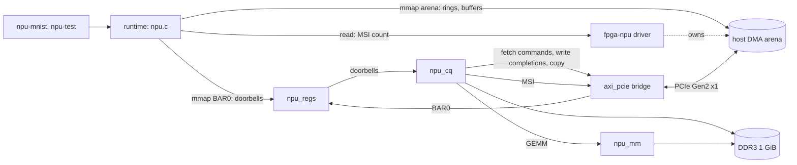

# Architecture

This document describes the boundaries that exist today and the decisions behind them. Planned work is in the [roadmap](ROADMAP.md); the [background](docs/edge-ai-accelerators.md) explains the products this design learns from.

## Product decision

Build a PCIe accelerator card the way commercial edge-AI modules are built, with an FPGA standing in for the ASIC, and keep every layer open. Reuse AMD's PCIe bridge and memory controller cores for the physical layers, so effort goes into the parts that make an accelerator: the control interface, the command queue and DMA, the compute engine, the driver and runtime, the compiler. Replace a reused part only when it blocks something the project needs to show, and say why (phase 3 replaced AMD's XDMA DMA core and driver; see below).

The host side targets embedded Linux on an NXP i.MX95, the class of host that discrete NPUs are sold for. Nothing in the card is specific to that host; any PCIe Linux machine that can build the `fpga-npu` driver can drive it.

## Implemented layers

| Layer | Implementation | Boundary |
| --- | --- | --- |
| Physical link | AC701 x4 edge connector, M.2 Key-M adapter, FRDM-i.MX95 PCIe 3.0 x1 | Trains at Gen2 x1; the slower end sets the speed. |
| PCIe endpoint | AMD's AXI Memory Mapped to PCI Express bridge (`axi_pcie`, PG055) in the `card_sys` block design (`hw/bd/card_sys.tcl`) | Configuration space (device `10ee:ed10`, class `12 00 00`), BAR0 as an AXI master, a slave window through which the card reads and writes host memory (AXI `0x8000_0000` reaches bus address 0, 2 GiB), MSI. 64-bit AXI at 125 MHz. |
| Control plane | `hw/rtl/npu_regs.v` on BAR0 | Every host-visible control and status bit of the card, the command queue's doorbells included. AXI4-Lite through a SmartConnect converter, on AMD's AXI4-Lite slave template. [Register map](docs/register-map.md). |
| Command queue | `hw/rtl/npu_cq.v` | Fetches 64-byte commands from a ring in host memory, runs them, writes 16-byte completions with a phase bit and card timestamps, requests MSIs. Copies between host and card memory stream through a FIFO. [Command queue](docs/command-queue.md). |
| Compute | `hw/rtl/npu_mm.v`, behind `npu_cq`'s `GEMM` command | INT8 matrix multiply with INT32 accumulation, bias, requantization and ReLU, reading and writing card memory. Tiles of 8 rows of A: each weight beat feeds 64 MACs per cycle on 64 DSP slices (8 GMAC/s peak, 6.5 measured). `sw/npu/npu_ref.py` is its bit-exact model. |
| Card memory | MIG, SmartConnect and DDR3 SODIMM in `card_sys` | 1 GiB of DDR3 at AXI address 0 (800 MT/s, 64 bits), shared by `npu_cq` (64-bit, 125 MHz), `mem_bw` (512-bit, 100 MHz) and a JTAG-to-AXI master. |
| Card-side memory engine | `hw/rtl/mem_bw.v` | 512-bit AXI4 bursts (4 KiB, up to 16 in flight) that measure DDR3 bandwidth without the PCIe link and check the data they read back. Controlled from BAR0 (`BW_*`). |
| Top level | `hw/rtl/npu_top.v` | Wires the parts; owns the reference and debug clocks, the LEDs and the DMA counters (`axi_dma_mon`). |
| Debug | System ILAs, VIO and JTAG-to-AXI in `card_sys`; DMA counters, DDR and queue status in BAR0 | Every problem can be seen from the host's registers, from Vivado over JTAG, or as AXI waveforms. [Debugging](docs/debugging.md). |
| Host driver | `sw/driver/fpga_npu.c` (GPL-2.0) | Owns the PCI device, one 32 MiB DMA arena (31-bit DMA mask, IOMMU on) and the MSI; exposes `/dev/fpga-npu` for `mmap` of the arena and BAR0, an info `ioctl`, and a blocking interrupt `read`. |
| Runtime | `sw/npu/npu.c`, `npu.h` | Rings, commands, doorbells, completions, memory carving, in user space, as accelerator stacks do. Tools on top: `npu-test` (acceptance tests), `npu-mnist`. |
| Bring-up tool | `sw/tools/npu-ctl.c` | Register access, latency, and (for phases 1 and 2 cards) XDMA DMA tests. |

## Decisions

**A bridge and an engine of our own instead of XDMA (phase 3).** Phases 1 and 2 used AMD's XDMA core and driver: a scatter-gather DMA engine with a maintained Linux driver, chosen over the bare PCIe block's TLP interface so the link worked early. But XDMA only moves data when the host's driver programs it, and on the Artix-7 it has no bridge mode, so the card could not fetch commands itself, which is how NVMe drives and AI accelerators work. Phase 3 switched to AMD's `axi_pcie` bridge, whose slave window lets card logic read and write host memory, and wrote the queue and DMA engine (`npu_cq`) and the driver for the project. AMD's XDMA driver also had a bug the IOMMU exposed (bring-up, "Problems found"); that path is history now.

**Gen2 x1, 64-bit AXI at 125 MHz.** The i.MX95 slot has one lane, so wider configurations would not train wider. At Gen2 x1, a 64-bit datapath at 125 MHz (1 GB/s) is more than the link's 500 MB/s, so the AXI side is never the bottleneck. PG055 gives 125 MHz for every configuration except Gen1 x1.

**Rings in host memory, doorbells in BAR0.** The host writes commands into its own memory and rings one doorbell for a batch; the card fetches them, and writes completions back with a phase bit, so the host never reads a card register on the fast path (each register read costs about 1.2 µs). This is NVMe's queue model.

**A small kernel driver, the queue in user space.** The kernel module only owns what needs privilege: the PCI device, the DMA arena, the interrupt. Commands are built and completions consumed by a user-space runtime that maps the arena and BAR0, the split accelerator stacks use to keep submission cheap. One arena of coherent memory, mapped through the i.MX95's IOMMU with a 31-bit mask to match the bridge window.

**`10ee:ed10` while this is a development board.** The bridge core defaults to AMD's vendor ID; `ed10` is not assigned to an AMD product, so no stock driver claims the card. A product would need its own vendor ID.

**One GEMM engine before a network-specific pipeline.** The first compute block is a general INT8 matrix multiply with requantization: with a model compiler, it runs any network that fits in card memory (Ara's approach). A pipelined, weights-on-chip variant (Hailo's) is the comparison planned for later.

**Reuse before more multipliers (0.5.0).** The first engine (0.4.0) read every weight once per row of A: 8 MACs per 8-byte beat, 0.87 GMAC/s, slower than one Cortex-A55 core with NEON (1.55 GMAC/s). The data was the limit, not the arithmetic: one 64-bit beat per cycle is all the card port delivers. Holding 8 rows of A on chip lets each weight beat do 8 times the work, so 0.5.0 reaches 6.5 GMAC/s from the same memory traffic. This is the arithmetic-intensity argument behind every NPU's on-chip buffers. It helps batches only: a single image (M = 1) still runs at 8 MACs per cycle, so one MNIST image takes the same 155 µs on both versions.

**Bitstream in SPI flash.** The host enumerates PCIe once at boot, and expects the card ready within about 100 ms of releasing PERST#. The card configures itself from flash at power-on, compressed to shorten configuration time, and is powered before the host.

**Non-project Tcl builds.** `hw/scripts/build.tcl` runs synthesis to bitstream from source and settings alone, so a clean clone builds with one command and the repository holds no generated files. Timing failure stops the build. `hw/scripts/create_project.tcl` makes a Vivado project from the same sources for exploring in the GUI; it is disposable.

**A block design only for AMD's cores.** The PCIe bridge, MIG, SmartConnects, resets and System ILAs, with their board-preset and debug automation, work best in IP Integrator, so they form one block design, `card_sys`, recreated by `hw/bd/card_sys.tcl` whenever that script changes (it was `card_mem` before phase 3). Everything written for this project stays in Verilog.

**AXI against AMD's templates.** `npu_regs` is built on Vivado's AXI4-Lite slave template, and `mem_bw`, `npu_cq` and `npu_mm` follow its AXI4 master template's rules (`hw/scripts/axil_template.tcl` regenerates both). Each block's testbench drives it the way the real peer does and has a protocol monitor; the two AXI rules that were broken during development (a read response in its address cycle, write data waiting for the address handshake) each have a test that fails against the old code.

**Debug cores on their own clock.** The debug hub and VIO run from the board's Si570 oscillator through an MMCM, not from the PCIe or MIG clocks, so the Hardware Manager can still reach them when there is no host or the memory controller is in reset.

## Verification

| Level | How | Where |
| --- | --- | --- |
| Command queue and GEMM engines | `tb_npu_cq`: the testbench plays the driver against two AXI memory models (host and card) with random stalls, read latency and slaves that wait for write data; NOPs in order across ring wraps, a full CQ stalling, copy round trips byte for byte, rejected commands, AXI errors, MSIs; GEMMs against a reference in the testbench (INT8 with and without ReLU, INT32, rejected shapes, K = 2048 with N = 1024, 19 rows in tiles of 8, 8 and 3), and against `npu_ref.py` from a memory dump (`sw/npu/check_gemm.py`). A phase-bit mutant and the N = 1024 bug each fail it. | `hw/sim/tb_npu_cq.v`, `hw/sim/axi_mem_model.v` |
| Register block | Self-checking XSim testbench: identity, byte strobes, channel ordering, read-only behavior, counter coherence, interrupt handshake, back-to-back reads with RREADY held high as XDMA does, and an AXI handshake-order monitor. | `hw/sim/tb_npu_regs.v`, `make sim` |
| Full design | Timing closure and DRC on every build. | `build/reports/` |
| Memory system on hardware | JTAG-only DDR3 test (`make jtag-memtest`), host `npu-ctl memtest` over the full 1 GiB, AXI protocol checkers in the System ILAs. | [Debugging](docs/debugging.md), [bring-up](docs/bringup.md) |
| Hardware | Bring-up checklist, filled in with dated results; `npu-test all` (queue, copies, random GEMMs against the CPU) and `npu-mnist` (10 000 images against the CPU and the bit-exact model), raw logs in `docs/results/`. | [docs/bringup.md](docs/bringup.md) |

The XDMA example simulation is not part of the flow: it exceeds the instance limit of Vivado's free simulator tier. The project's own blocks are kept small enough to test in XSim, and the PCIe path is tested on hardware.
