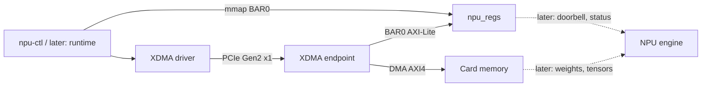

# Architecture

This document describes the boundaries that exist today and the decisions behind them. Planned work is in the [roadmap](ROADMAP.md); the [background](docs/edge-ai-accelerators.md) explains the products this design learns from.

## Product decision

Build a PCIe accelerator card the way commercial edge-AI modules are built, with an FPGA standing in for the ASIC, and keep every layer open. Reuse AMD's PCIe DMA core (XDMA) and AMD's reference Linux driver for the transport, so effort goes into the parts that make an accelerator: the control interface, the on-card memory system, the compute engine, the compiler and the runtime. Replace a reused part only when it blocks something the project needs to show, and say why.

The host side targets embedded Linux on an NXP i.MX95, the class of host that discrete NPUs are sold for. Nothing in the card is specific to that host; any PCIe Linux machine with the XDMA driver can drive it.

## Implemented layers

| Layer | Implementation | Boundary |
| --- | --- | --- |
| Physical link | AC701 x4 edge connector, M.2 Key-M adapter, FRDM-i.MX95 PCIe 3.0 x1 | Trains at Gen2 x1; the slower end sets the speed. |
| PCIe endpoint | XDMA (AMD PG195), `hw/scripts/ip.tcl` | Configuration space, BARs, MSI, the DMA engine. Generated at build time, never edited. |
| Control plane | `hw/rtl/npu_regs.v` on BAR0 | Every host-visible control and status bit of the card. Single-beat AXI-Lite, 125 MHz, on AMD's AXI4-Lite slave template (`hw/scripts/axil_template.tcl` regenerates it). [Register map](docs/register-map.md). |
| Data plane | XDMA H2C/C2H channels to an AXI BRAM controller | Bulk data between host memory and card memory. Phase 1: 64 KiB BRAM at AXI address 0. |
| Top level | `hw/rtl/npu_top.v` | Wires the parts; owns clocks, resets and LEDs. No logic of its own beyond the heartbeat. |
| Host driver | Xilinx `dma_ip_drivers` XDMA, unmodified | Owns BAR1 and the descriptor rings; exposes `/dev/xdma0_*`. |
| Host tool | `sw/tools/npu-ctl.c` | Bring-up and measurement: registers, latency, DMA loopback. Not the runtime. |

## Decisions

**XDMA instead of a hand-written PCIe transaction layer.** The previous experiment in this workspace drove the 7-series PCIe block directly with the PIO example. That shows TLPs but leaves DMA, descriptor handling and interrupts to write from scratch, and those are not the subject of this project. XDMA provides a scatter-gather engine of the kind real accelerators use, plus a maintained Linux driver.

**Gen2 x1, 64-bit AXI at 125 MHz.** The i.MX95 slot has one lane, so wider configurations would not train wider. At Gen2 x1, a 64-bit datapath at 125 MHz (1 GB/s) is more than the link's 500 MB/s, so the AXI side is never the bottleneck.

**Control and data on separate BARs.** BAR0 is the card's own register map; BAR1 belongs to the DMA engine and its driver. A runtime can map BAR0 into user space without touching the driver's registers, which is how accelerator stacks keep doorbells cheap.

**AMD's IDs and driver for now.** `10ee:7021` makes the stock XDMA driver bind without changes. A project ID comes with the project's own driver (roadmap phase 3).

**Bitstream in SPI flash.** The host enumerates PCIe once at boot, and expects the card ready within about 100 ms of releasing PERST#. The card configures itself from flash at power-on, compressed to shorten configuration time, and is powered before the host.

**Non-project Tcl builds.** `hw/scripts/build.tcl` runs synthesis to bitstream from source and settings alone, so a clean clone builds with one command and the repository holds no generated files. Timing failure stops the build.

## Verification

| Level | How | Where |
| --- | --- | --- |
| Register block | Self-checking XSim testbench: identity, byte strobes, channel ordering, read-only behavior, counter coherence, interrupt handshake, back-to-back reads with RREADY held high as XDMA does, and an AXI handshake-order monitor. | `hw/sim/tb_npu_regs.v`, `make sim` |
| Full design | Timing closure and DRC on every build. | `build/reports/` |
| Hardware | Bring-up checklist, filled in with dated results. | [docs/bringup.md](docs/bringup.md) |

The XDMA example simulation is not part of the flow: it exceeds the instance limit of Vivado's free simulator tier. The project's own blocks are kept small enough to test in XSim, and the PCIe path is tested on hardware.
