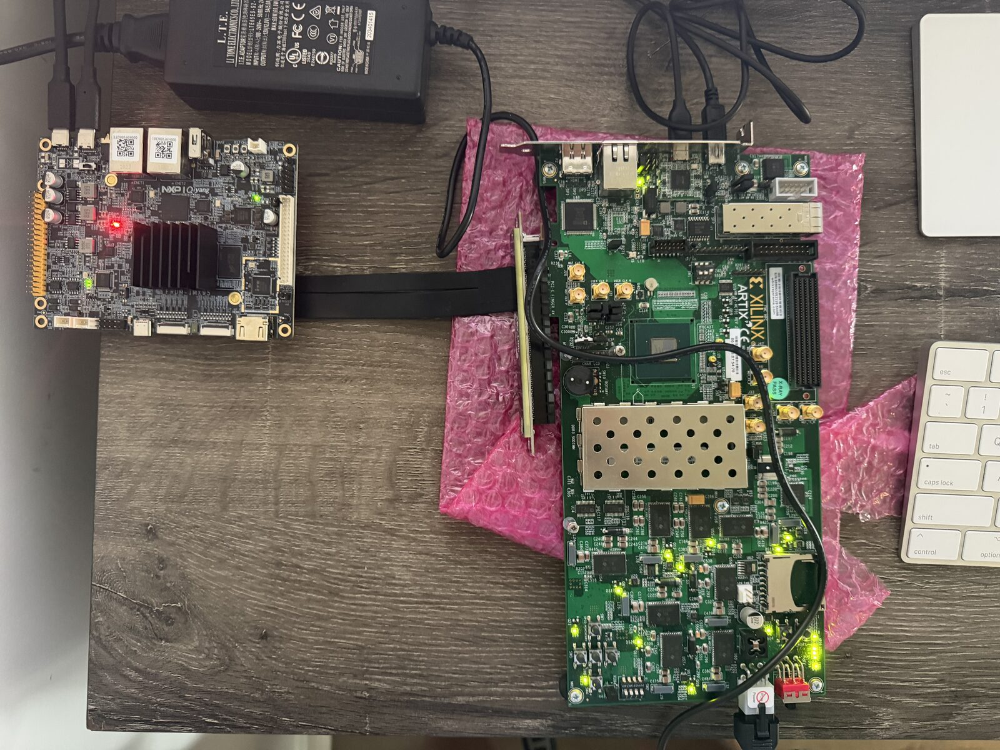
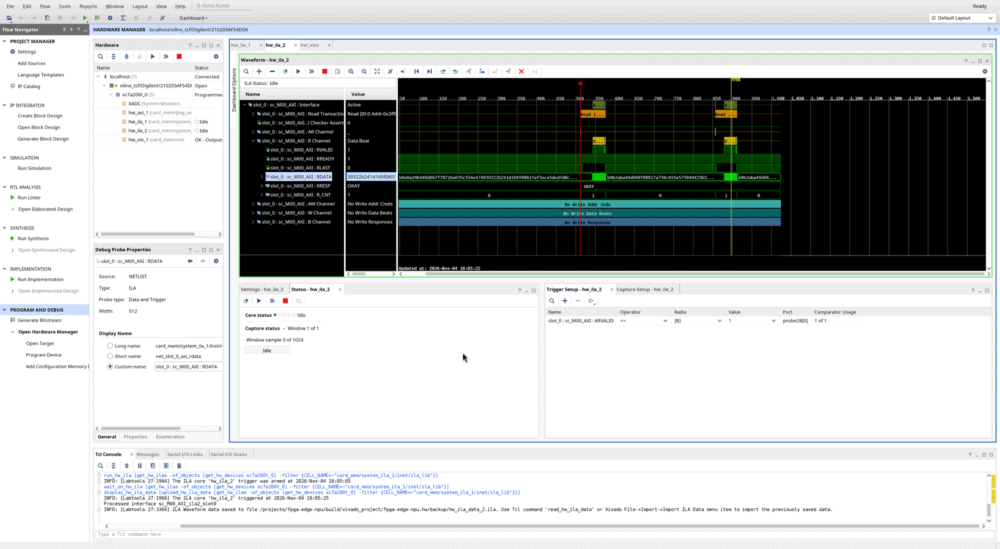

# fpga-edge-npu

An open neural-processing card built on an FPGA. The card plugs into an embedded Linux host over PCIe, the way a Hailo-8 or an NXP Ara-2 module does, and every layer is open to read: the PCIe endpoint, the DMA path, the register map, the host driver and tools, and (in later phases) the inference engine and the model compiler.

The reference pair is an AMD **AC701** (Artix-7 200T) as the card and an NXP **FRDM-i.MX95** as the host, joined through the i.MX95 board's M.2 Key-M slot. The goal is to learn and show, by building one, how a discrete edge-AI accelerator works from the bus up.

**Status: phases 1 to 3 done; phase 4 (compute engine) has its GEMM working on the card.** The FRDM-i.MX95 drives the card through the project's own driver and a command queue the card fetches from host memory, NVMe style: 505 000 commands/s, 3.8 µs for one command's round trip, copies at 419 MB/s over PCIe Gen2 x1. The card's INT8 matrix engine runs an MNIST network at 97.11 % accuracy, bit for bit the same as the CPU, at 55 000 images/s: 4 times one Cortex-A55 core. [Bring-up](docs/bringup.md) has every measurement and the problems found on the way, including a cache-maintenance bug in AMD's XDMA driver that the i.MX95's IOMMU exposed in phase 2; [debugging](docs/debugging.md) covers the ILAs, VIO and JTAG tests built into the card. Next: convolutions and a model compiler ([roadmap](ROADMAP.md)).

Created by **Edgar Duarte**. Apache-2.0 licensed, except the Linux kernel driver in `sw/driver/`, which is GPL-2.0 as kernel modules must be.

**[Interactive explainer](https://edgaralejod.github.io/fpga-edge-npu/)** · [Architecture](ARCHITECTURE.md) · [Roadmap](ROADMAP.md) · [How edge-AI cards work](docs/edge-ai-accelerators.md) · [Hardware setup](docs/hardware-setup.md) · [Bring-up](docs/bringup.md) · [Debugging](docs/debugging.md) · [Register map](docs/register-map.md) · [Command queue (design)](docs/command-queue.md) · [Contribute](CONTRIBUTING.md)



*The bench: the FRDM-i.MX95 host (left) drives the AC701 card (right) over PCIe Gen2 x1, through an M.2 Key-M to PCIe x4 riser cable into the AC701's edge connector. Each board runs from its own supply.*

## What it is today

```
 FRDM-i.MX95 (host)                          AC701 (card)
 ┌────────────────────────┐   PCIe Gen2 x1   ┌──────────────────────────────────┐
 │ Linux                  │   M.2 Key-M to   │ axi_pcie bridge (10ee:ed10)      │
 │  npu-mnist, npu-test   │◄────────────────►│  BAR0 ─► npu_regs (doorbells)    │
 │  runtime (npu.c)       │   x4 slot riser  │  npu_cq ◄─► host memory: fetches │
 │  fpga-npu driver       │                  │     commands, copies, completions│
 │  DMA arena: SQ, CQ,    │                  │  npu_mm: INT8 GEMM, 64 MAC/clock │
 │  tensors               │                  │  1 GiB DDR3 card memory          │
 └────────────────────────┘                  └──────────────────────────────────┘
```

- **PCIe endpoint.** AMD's AXI Memory Mapped to PCI Express bridge, Gen2 x1, class code `12 00 00` (processing accelerator). The i.MX95 slot is a single PCIe 3.0 lane and the Artix-7 tops out at Gen2, so the link trains at 5 GT/s x1. The bridge has no DMA engine of its own: the card's logic reads and writes host memory through it.
- **Control plane (BAR0).** `npu_regs`: identity, version, a cycle counter, interrupt test, DDR3 status, DMA counters, the bandwidth engine, and the command queue's settings and doorbells. See the [register map](docs/register-map.md).
- **Command queue.** `npu_cq` fetches 64-byte commands from a ring in host memory after a doorbell, runs them (no-op, copies between host and card memory, GEMM), and writes 16-byte completions with a phase bit, status and card timestamps, with an MSI on request. See [command queue](docs/command-queue.md).
- **Compute.** `npu_mm` multiplies INT8 matrices from card memory with INT32 sums, bias, scaling, rounding, ReLU and clamping, on tiles of 8 rows: 64 multiply-accumulates per clock on 64 DSP slices, 6.5 GMAC/s measured. `sw/npu/npu_ref.py` is its bit-exact model.
- **Card memory.** The AC701's 1 GiB DDR3 SODIMM behind AMD's memory controller (MIG): 5.9 GB/s inside the card, sixteen times what the link carries.
- **Host software.** `fpga-npu` (`sw/driver/`), a small kernel driver that owns the device, a 32 MiB DMA arena and the MSI; a user-space runtime (`sw/npu/npu.c`) that builds commands and reads completions in the mapped arena; `npu-test` and `npu-mnist` on top. `npu-ctl` remains the bring-up tool for registers.
- **Debug.** System ILAs with AXI protocol checkers on both sides of the memory interconnect and on the bridge's host-memory port, a VIO, a JTAG-to-AXI master and DMA counters in BAR0; see [debugging](docs/debugging.md).



*Inside the card: the System ILA on the DDR3 controller's AXI port, in Vivado's Hardware Manager. Triggered on `ARVALID`, it shows two read transactions arriving at the memory controller, their 512-bit data beats with `OKAY` responses, and no AXI protocol checker assertions. [Debugging](docs/debugging.md) explains how to capture this.*

## Build

You need Vivado 2025.2 (the free Standard edition covers the Artix-7 200T). From the repository root:

```sh
make bitstream      # build/npu_top.bit and build/npu_top.mcs (SPI flash image)
make sim            # the XSim testbenches (registers, bandwidth engine, queue and GEMM); each prints RESULT: PASS
make tools          # npu-ctl for this machine
make tools CC=aarch64-linux-gnu-gcc   # npu-ctl for the i.MX95
make project        # a Vivado project in build/vivado_project, to explore in the GUI
```

From a clean clone `make bitstream` takes about 20 minutes on an 8-core machine. It stops with an error if timing is not met; reports land in `build/reports/`. If Vivado runs in a container on your machine, set `XRUN` to the command prefix that runs a program inside it (see the [Makefile](Makefile)).

The host side: `sw/driver/` builds `fpga_npu.ko` against the i.MX95's kernel tree, `make -C sw/npu` builds the runtime, `npu-test` and `npu-mnist` (natively on the board, or with `CC=aarch64-linux-gnu-gcc`), and `sw/mnist/train.py` trains and quantizes the MNIST network (NumPy). Then follow [hardware setup](docs/hardware-setup.md) to connect the boards and [bring-up](docs/bringup.md) to flash the card and run the tests from the i.MX95.

## Repository layout

| Path | Contents |
| --- | --- |
| `hw/rtl/` | Verilog written for this project: `npu_top` (AC701 top level), `npu_regs` (BAR0 registers), `npu_cq` (command queue and DMA), `npu_mm` (INT8 matrix engine), `mem_bw` (DDR3 bandwidth engine), `axi_dma_mon`, `fifo_fwft`. |
| `hw/constr/` | AC701 pin, clock and configuration constraints. |
| `hw/bd/` | `card_sys.tcl`: AMD's cores as a block design: PCIe bridge, DDR3 memory system, interconnect, debug cores. |
| `hw/scripts/` | `ip.tcl` creates the AMD IP cores from settings; `build.tcl` runs synthesis to bitstream; `create_project.tcl` makes a Vivado project for the GUI; `program.tcl` loads and flashes over JTAG; `debug.tcl` checks DDR3 over JTAG; `axil_template.tcl` regenerates the AXI4-Lite template `npu_regs` is based on. |
| `hw/sim/` | Self-checking XSim testbenches and `axi_mem_model`, an AXI memory that checks the master's handshakes. |
| `sw/driver/` | `fpga-npu`, the Linux kernel driver (GPL-2.0): DMA arena, BAR0, MSI. |
| `sw/npu/` | The user-space runtime (`npu.c`), `npu-test` (acceptance tests), `npu-mnist`, and `npu_ref.py`, the bit-exact model of the GEMM engine. |
| `sw/mnist/` | `train.py`: trains and quantizes the MNIST network the card runs. |
| `sw/tools/` | `npu-ctl`, the bring-up tool; `cacheprobe`, a check for stale CPU cache lines after card-to-host DMA. |
| `sw/scripts/`, `sw/patches/` | Phases 1 and 2: loading AMD's XDMA driver at boot on the FRDM-i.MX95, and the fix for its IOMMU bug (see [bring-up](docs/bringup.md)). |
| `docs/` | Background, hardware setup, bring-up, debugging, register map, command queue; `docs/results/` holds the raw logs of the hardware runs. |
| `site/` | The [explainer website](https://edgaralejod.github.io/fpga-edge-npu/) (GitHub Pages, `make site-publish`): draw a digit and run the card's network in the browser, one inference timed by the card, interactive system map, animated data flows, measured numbers. |

The repository holds only source and settings. AMD IP (the PCIe bridge, MIG, SmartConnects and debug cores, all in the block design) is generated at build time from `hw/bd/card_sys.tcl`, never committed.

## Limits

This is a learning and portfolio project, not a product. It is not certified for any use, and it is not affiliated with AMD, NXP, Hailo or Kinara; their product names describe what this project compares itself with. Performance figures in these docs are labelled as measured, estimated, or from vendor documents.

---

<sub>Published by Virtu Services LLC ([virtu-services.us](https://virtu-services.us)).</sub>
