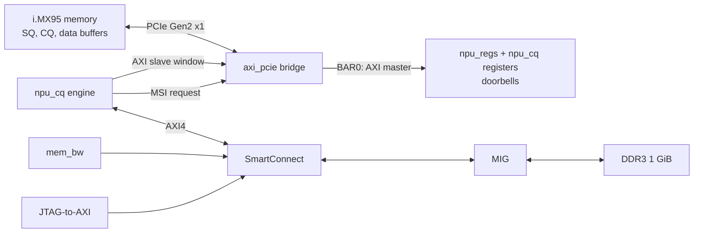

# Command queue (phase 3 design)

Status: the queue engine (`hw/rtl/npu_cq.v`) and the matrix engine behind its `GEMM` command (`hw/rtl/npu_mm.v`) are written and pass their testbench (`hw/sim/tb_npu_cq.v`); they are not in the bitstream yet, and the driver is not written. This document is the contract between the engine and the project's Linux driver (`fpga-npu`). Change both together.

## Why a queue

A host that drives an accelerator through register writes pays a PCIe round trip per step: phase 1 measured 1.18 µs for one register read on the FRDM-i.MX95. Real accelerators (NVMe drives, Hailo-8, Ara-2, GPUs) instead let the host write a batch of commands into a ring in its own memory and ring one doorbell. The card fetches the commands itself, executes them, writes a completion record back into host memory and raises an interrupt. The host never reads a card register on the fast path; it only polls its own memory. This phase builds that loop.

## What changes in the card

XDMA's DMA engine only moves data when the host's driver programs it, so the card cannot fetch commands with it, and the Artix-7 version of XDMA has no bridge mode. Phase 3 replaces XDMA with AMD's AXI Memory Mapped to PCI Express bridge (`axi_pcie` 2.9, PG055), still Gen2 x1:

| Path | Direction | Through |
| --- | --- | --- |
| Registers and doorbells | host writes, card reads | BAR0 → bridge AXI master → `npu_regs` |
| Commands | card reads host memory | `npu_cq` → bridge AXI slave → PCIe memory reads |
| Completions and copied data | card writes host memory | `npu_cq` → bridge AXI slave → PCIe memory writes |
| Card memory | card reads and writes | `npu_cq` → SmartConnect → MIG |
| Interrupts | card to host | `npu_cq` → bridge MSI request |

PERST# does not reach the bridge directly: AMD's reference design (PG055) feeds it to a `proc_sys_reset` block (`aux_reset_in`, active low) with the bridge's `mmcm_lock` on `dcm_locked`, whose `interconnect_aresetn` drives the bridge's `axi_aresetn`. The bridge's BAR0 side is a full AXI4 master, so an AXI4 to AXI4-Lite converter sits in front of `npu_regs`. MSI requests are one-cycle pulses answered by a one-cycle grant; `npu_cq` keeps one request in flight.

The bridge's slave window maps AXI addresses `0x8000_0000`–`0xFFFF_FFFF` to PCIe bus addresses `0x0000_0000`–`0x7FFF_FFFF`, a fixed translation. The driver restricts its DMA mask to 31 bits so every buffer the IOMMU maps for the card falls inside that window.

The PCI ID becomes `10ee:ed10`, class `12 00 00`. `10ee` is AMD's vendor ID, used because the bridge core defaults to it and this is a development board; `ed10` is not an ID AMD has assigned to anything, so the stock XDMA driver no longer binds and `fpga-npu` does. A product would need its own vendor ID.

## Queues

One submission queue (SQ) and one completion queue (CQ), both rings in host memory allocated by the driver with `dma_alloc_coherent()`.

| Ring | Entry | Entries | Written by | Read by |
| --- | --- | --- | --- | --- |
| SQ | 64-byte command | power of two, 2 to 4096 | host | card (DMA read) |
| CQ | 16-byte completion | same as the SQ | card (DMA write) | host |

Indices count entries and wrap at the ring size.

- **SQ tail doorbell.** The host writes commands at `sq_tail`, advances it, and writes the new value to `CQ_SQ_TAIL`. The card fetches from its private `sq_head` up to the doorbell value.
- **CQ phase bit.** The card writes completions at its private `cq_tail`. Each entry carries a phase bit that the card inverts every time `cq_tail` wraps to 0, starting at 1. The host consumes entries while their phase bit equals the phase it expects, so it never reads a card register to find new completions (NVMe's scheme).
- **CQ head doorbell.** After consuming completions the host writes its `cq_head` to `CQ_CQ_HEAD`. The card never writes a completion into a slot the host has not released, so a slow host stalls the card instead of losing completions.
- **Back pressure.** The host keeps at most `entries - 1` commands outstanding. The card reports its `sq_head` in every completion, so the host knows which SQ slots are free again without a register read.

## Command (64 bytes, little-endian)

| Bytes | Field | Meaning |
| --- | --- | --- |
| 0 | `opcode` | See below |
| 1 | `flags` | `[0]` raise an interrupt when this command completes |
| 2–3 | `cid` | Command ID chosen by the host, echoed in the completion |
| 4–7 | `length` | Bytes to move (copies); a multiple of 64 |
| 8–15 | `host_addr` | PCIe bus address in host memory (copies) |
| 16–23 | `card_addr` | Address in card memory (copies) |
| 24–63 | reserved | Zero |

| Opcode | Name | Action |
| --- | --- | --- |
| `0x00` | `NOP` | Nothing; completes at once. Measures the queue's own overhead. |
| `0x01` | `COPY_H2C` | Copy `length` bytes from host memory to card memory. |
| `0x02` | `COPY_C2H` | Copy `length` bytes from card memory to host memory. |
| `0x10` | `GEMM` | INT8 matrix multiply in card memory, by `npu_mm` (below). |
| others | | Completed with status `INVALID_OPCODE`. |

### `GEMM` (opcode `0x10`)

Computes `C = requant(A · Btᵀ + bias)` entirely in card memory. A is M × K INT8, Bt is the second operand stored transposed (N × K INT8, so both are read along rows), bias is N INT32, all rows packed. `hw/rtl/npu_mm.v` implements it; `sw/npu/npu_ref.py` is the bit-exact Python model, and the two are compared in `hw/sim/tb_npu_cq.v` and `sw/npu/check_gemm.py`.

| Bytes | Field | Meaning |
| --- | --- | --- |
| 0 | `opcode` | `0x10` |
| 1 | `flags` | `[0]` raise an interrupt when it completes |
| 2–3 | `cid` | Command ID |
| 4–7 | `M` | Rows of A and C, at least 1 |
| 8–11 | `a_addr` | A in card memory |
| 12–15 | `bt_addr` | Bt in card memory |
| 16–19 | `c_addr` | C in card memory |
| 20–23 | `bias_addr` | bias in card memory |
| 24–25 | `K` | Multiple of 64, up to 2048 |
| 26–27 | `N` | Multiple of 64, up to 1024 |
| 28 | `shift` | `[4:0]` right shift after scaling |
| 29 | `mode` | `[0]` ReLU, `[1]` INT32 output (C is M × N INT32, no scaling) |
| 30–31 | `mult` | Unsigned scale |

For INT8 output, `C[m][n] = clamp(relu?((acc · mult + 2^(shift−1)) >> shift), −128, 127)` with an arithmetic shift (no rounding term when `shift` is 0), where `acc = Σ A[m][k]·Bt[n][k] + bias[n]` in 32 bits. All four addresses are 64-byte aligned, and every region lies inside the 1 GiB of card memory; otherwise the command completes with `BAD_LENGTH` and nothing runs.

The engine loads one row of A into block RAM, streams all of Bt past it at one 64-bit beat (eight multiply-accumulates) per 125 MHz cycle, and writes the row of C: about M × N × K / 8 cycles per command, with B re-read for every row of A. That is enough to run a small network and to measure; reusing B across rows is the obvious next step.

## Completion (16 bytes, little-endian)

| Bytes | Field | Meaning |
| --- | --- | --- |
| 0–1 | `cid` | The command's ID |
| 2–3 | `sq_head` | The card's SQ head after fetching this command |
| 4 | `status` | 0 success, 1 invalid opcode, 2 bad length, 3 AXI error |
| 5 | `phase` | `[0]` phase bit |
| 6–7 | reserved | Zero |
| 8–11 | `t_fetch` | Card cycle counter (125 MHz) when the command arrived |
| 12–15 | `t_done` | Card cycle counter when the work finished |

`t_done − t_fetch` is the card's execution time for the command; the host adds its own timestamps around the doorbell write to get the full round trip.

## Registers (BAR0, `npu_regs`, new in 0.4.0)

| Offset | Name | Access | Meaning |
| --- | --- | --- | --- |
| `0x080` | CQ_CTRL | RW | `[0]` enable (resets indices and phase when set), `[1]` interrupts enabled |
| `0x084` | CQ_ENTRIES_LOG2 | RW | Ring size as a power of two (1 to 12) |
| `0x088` | CQ_SQ_BASE_LO | RW | SQ bus address, low 32 bits (64-byte aligned) |
| `0x08C` | CQ_SQ_BASE_HI | RW | SQ bus address, high 32 bits (zero while the window is 31 bits) |
| `0x090` | CQ_CQ_BASE_LO | RW | CQ bus address, low 32 bits (16-byte aligned) |
| `0x094` | CQ_CQ_BASE_HI | RW | CQ bus address, high 32 bits |
| `0x098` | CQ_SQ_TAIL | WO | Doorbell: the host's new SQ tail |
| `0x09C` | CQ_CQ_HEAD | WO | Doorbell: the host's new CQ head |
| `0x0A0` | CQ_STATUS | RO | `[0]` busy, `[1]` stalled on a full CQ, `[2]` AXI error seen (sticky until disable) |
| `0x0A4` | CQ_COMPLETED | RO | Commands completed since enable |

The settings registers (`CQ_ENTRIES_LOG2`, the base addresses) ignore writes while the queue is enabled.

## Acceptance (roadmap phase 3)

- 10 000 or more `NOP` commands, submitted in batches, each completed exactly once, in order, with matching `cid`s and correct phase bits.
- `COPY_H2C` then `COPY_C2H` round trips of host buffers through card memory match byte for byte, with the IOMMU translating.
- Per-command latency: the card's `t_done − t_fetch`, and the host's doorbell-to-completion time, reported as distributions.
- The driver passes the same tests after `rmmod` and `insmod`, and after the host reboots with the card left powered.

## Open questions

| Question | Plan |
| --- | --- |
| Commands fetched one at a time or in bursts? | Start with one 64-byte read per command; measure; fetch several when the doorbell shows a backlog. |
| Interrupt per command or coalesced? | Per command when `flags[0]` is set; the host sets it on the last command of a batch. Add a timer-based coalescer if the host spends its time in the interrupt handler. |
| Copies through the 64-bit bridge, or wider? | The bridge's AXI side is 64 bits at 125 MHz for Gen2 x1 (PG055, and AMD's IP script for `axi_aclk_out`): 1 GB/s, above the 500 MB/s the link carries, so the bridge is not the limit. In simulation `npu_cq` moves a 32 KiB copy in 4414 cycles for 4096 beats, 93 % of one beat per cycle. |
| Fixed or programmable translation window? | Fixed (`0x8000_0000` → bus address 0, 2 GiB) with a 31-bit DMA mask; to be confirmed against PG055 and on hardware. The bridge can also expose its translation registers (`INCLUDE_BAROFFSET_REG`) if the i.MX95's IOMMU hands out addresses above 2 GiB. |
