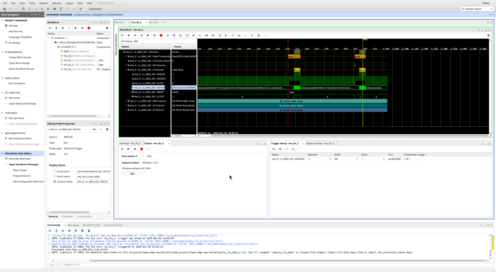

# Debugging the card

The card carries its own instruments, so a problem in the memory system can be seen from three places: the host's registers, Vivado over the JTAG cable, and waveforms captured inside the FPGA. Start with the cheapest view that answers the question.

| Question | Tool | Needs |
| --- | --- | --- |
| Is the DDR3 calibrated? Did DMA reach the memory system? Did it return errors? | `npu-ctl info` (BAR0 registers) | The i.MX95 |
| Is the DDR3 calibrated, with no host at all? Reset the memory controller. | `make ddr-status`, `make ddr-reset` (VIO) | The JTAG cable |
| Does the DDR3 work, with PCIe out of the picture? | `make jtag-memtest` (JTAG-to-AXI master) | The JTAG cable |
| What exactly happened on the AXI bus? Was the AXI protocol broken? | System ILAs in the Hardware Manager | The JTAG cable, Vivado GUI |

## What is in the FPGA

| Core | Where | Clock | What it gives |
| --- | --- | --- | --- |
| `axi_dma_mon` | `hw/rtl/axi_dma_mon.v`, on XDMA's AXI4 master | PCIe user clock, 125 MHz | `DMA_WRITES`, `DMA_READS`, `DMA_ERRORS` in BAR0 |
| `npu_regs` STATUS | `hw/rtl/npu_regs.v` | PCIe user clock | `[1]` DDR3 calibrated, `[2]` DDR3 clock locked |
| System ILA on the PCIe side (`system_ila_0`) | `card_mem` block design, on `S_AXI_PCIE` | PCIe user clock | 2048 samples of XDMA's AXI4 traffic, with an AXI protocol checker |
| System ILA on the MIG side (`system_ila_1`) | `card_mem`, on the MIG's AXI port | MIG `ui_clk`, 100 MHz | 1024 samples of the 512-bit AXI traffic into the MIG, with a protocol checker |
| VIO | `card_mem` | Debug clock, 78.125 MHz | Inputs: calibration done, MMCM locked. Output: MIG reset request |
| JTAG-to-AXI master | `card_mem`, second master on the SmartConnect | MIG `ui_clk` | Reads and writes DDR3 from Vivado Tcl |

The debug hub, the VIO and the ILAs' JTAG side run from the AC701's Si570 user clock (156.25 MHz at power-up, divided to 78.125 MHz in `npu_top`). That clock does not depend on the PCIe host or on the MIG, so Vivado can still reach the debug cores when the link is down or the memory controller is held in reset. The ILA on the PCIe side samples only while the host supplies the PCIe reference clock; the Hardware Manager reports its clock as not running otherwise.

The System ILAs' protocol checkers flag AXI handshake and ordering violations. The bug that reached hardware in phase 1 (a read response raised in the same cycle as its address handshake) is the kind of fault they catch.

## From the host

```sh
sudo ./npu-ctl info
#   status    link up, ddr calibrated, ddr clock locked
#   dma axi   1024 writes, 1024 reads, 0 error responses
```

The DMA counters count AXI bursts on XDMA's side of the interconnect and wrap at 2³². Compare them before and after a transfer: no change means the DMA never reached the card's memory system; error responses mean it did and the interconnect or the MIG refused it.

`npu-ctl dmatest` and `npu-ctl memtest` refuse to run while STATUS says the DDR3 is not calibrated.

## Over JTAG, without the host

Load a phase 2 bitstream (from flash or with `make program`), then:

```sh
make ddr-status     XRUN="fpga run 2025.2 --"   # calibration and lock, cores present
make ddr-reset      XRUN="fpga run 2025.2 --"   # pulse the MIG reset, report again
make jtag-memtest   XRUN="fpga run 2025.2 --"   # every address line, five data patterns
```

These use `build/npu_top.ltx`, written by `make bitstream`, to name the probes; it must come from the same build as the loaded bitstream. `jtag-memtest` writes one word per address line (walking ones up to 1 GiB) before reading any back, so a stuck or shorted address line shows up as one address overwriting another.

Pressing CPU_RESET (SW8) also resets the MIG, which then recalibrates.

## Waveforms

Open the project (`make project`, then `fpga vivado 2025.2 /projects/fpga-edge-npu/build/vivado_project/fpga-edge-npu.xpr`), or any Vivado, and in the Hardware Manager:

1. Open Target, Auto Connect.
2. Select the `xc7a200t_0` device, set the Probes file to `build/npu_top.ltx`, Refresh Device.
3. Pick the ILA for the side under test (PCIe or MIG). Its AXI interface appears as a bus with decoded transactions.
4. Set a trigger, for example `ARVALID == 1` on the MIG side, Run Trigger, and start the transfer from the host (`npu-ctl dmatest 4096 1`) or from `make jtag-memtest`.

Capture qualification is enabled on both ILAs, so storing only cycles with a valid handshake stretches the window over longer transfers.



*A capture from the MIG-side ILA (`hw_ila_2`, `card_mem/system_ila_1`), 2026-11-04. The trigger is `ARVALID == 1` on `sc_M00_AXI`, the SmartConnect's port into the MIG. The interface row decodes two read transactions; the R channel shows their 512-bit `RDATA` beats with `RRESP = OKAY`; the AW, W and B channels are idle; and the protocol checker's assertion count (`Checker Assert`) is 0. The hardware tree on the left lists every debug core: `hw_axi_1` (JTAG-to-AXI), `hw_ila_1` and `hw_ila_2`, and `hw_vio_1`.*
