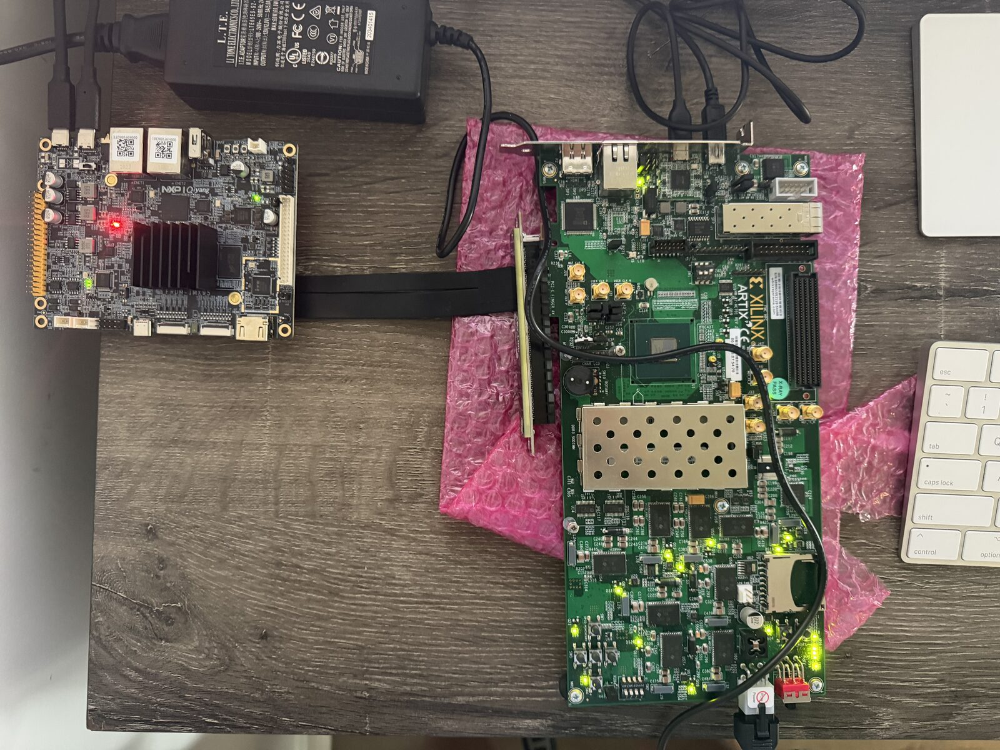

# Hardware setup

The card is an AMD AC701 evaluation board; the host is an NXP FRDM-i.MX95. The AC701 is built as a PCIe add-in card with a x4 edge connector. The FRDM-i.MX95 has no PCIe slot, only an M.2 Key-M socket wired to one PCIe 3.0 lane. An adapter joins the two.

## Parts

| Part | Notes |
| --- | --- |
| AMD AC701 (HW-A7-AC701), XC7A200T-2FBG676C | Revision 2 is what this project uses. Its own 12 V supply powers it. |
| NXP FRDM-i.MX95 | M.2 Key-M socket, PCIe 3.0 x1 ([block diagram](https://www.nxp.com/assets/block-diagram/en/FRDM-IMX95.pdf)). |
| M.2 Key-M to PCIe x4 (or x16) slot adapter, on a cable | Must carry the reference clock (REFCLK±), PERST#, and the TX/RX pair of lane 0. Prefer one with a separate power input for the slot, or at least one that does not try to power the card from the M.2 socket's 3.3 V. |
| USB cable for the AC701's JTAG (Digilent USB) | For programming and Vivado's hardware manager. |
| USB cable for the AC701 UART and the FRDM-i.MX95 debug UART | Consoles. |

## AC701 connectors and switches

From UG952 v1.4.

| Item | Reference | Use in this project |
| --- | --- | --- |
| USB JTAG | U26, micro-B | Programming and `make status`. Works in any SW1 setting; JTAG configuration overrides flash boot. |
| USB UART | J17, mini-B (CP2103 U44) | Not used by the design yet. Powered from the host's USB, so it enumerates with the board off. |
| Mode switch | SW1: position 1 = M2, 2 = not connected, 3 = M0; on = 1 | `001`: boot from SPI flash (required for PCIe). `101`: JTAG only. |
| Power | SW15, 12 V into J49; DS22 lit when on | Use the supplied 12 V adapter. An ATX 6-pin plug has a different pinout and damages the board. |
| DONE LED | DS10 | Lit once the FPGA is configured. |
| PCIe lane size | J12, default pins 3–4 (x4) | Leave as is. |
| CPU_RESET | SW8, active high | Resets the DDR3 controller (MIG), which then recalibrates. |
| User clock | Si570 U34, 156.25 MHz at power-up, pins M21/M22 | Clocks the debug cores (divided to 78.125 MHz). Do not reprogram it over I2C while debugging. |
| DDR3 | SODIMM J1, Micron MT8JTF12864HZ-1G6 (1 GiB) | Card memory since phase 2; the MIG runs it at 800 MT/s from the 200 MHz system clock (R3/P3). |

On the build machine, the Digilent JTAG appears as `0403:6010` and also creates two `/dev/ttyUSB*` nodes through `ftdi_sio`; the CP2103 UART is the third.

## Connecting

*The FRDM-i.MX95 (left) with the riser's M.2 end in its Key-M socket; the flat cable runs to the riser's PCIe slot, which holds the AC701's x4 edge connector (right). The AC701 sits on an antistatic bag on its own 12 V supply.*

1. Remove any SSD or AI module from the FRDM-i.MX95's M.2 Key-M socket and fit the adapter's M.2 end.
2. Plug the AC701's edge connector into the adapter's slot. Support the AC701 so the cable is not carrying its weight.
3. Power the AC701 from its own 12 V supply, not from the adapter. Both boards must share a ground. The adapter cable's ground pins do this, but check continuity between the two boards' ground test points with a meter before powering up.
4. Connect the AC701 JTAG USB to the build machine.

The link width is negotiated, so the AC701's PCIe lane-size jumper (which only drives the presence-detect pins) does not affect training here; leave it at its default. Check UG952 for its location if you change adapters.

## Power-up order

PCIe expects the card to be configured and ready within about 100 ms of the host releasing PERST#. The FPGA cannot reload in time if both boards start together and the bitstream comes over JTAG. So:

1. Program the SPI flash once with `build/npu_top.mcs` (see [bring-up](bringup.md)). The AC701 then configures itself from flash at power-on; the compressed image keeps that short.
2. Power the AC701 first. Wait for its DONE LED.
3. Power the FRDM-i.MX95. Linux enumerates the card while booting.

If you reload the FPGA over JTAG while the i.MX95 is running, the link drops. Reboot the i.MX95 to enumerate it again; a sysfs rescan may not retrain the link on this host (not yet tested).

## Status of these steps

Checked on hardware, 2026-11-04: JTAG programming and flash boot. The configuration settings in `hw/constr/ac701.xdc` (`CFGBVS VCCO`, `CONFIG_VOLTAGE 3.3`) match UG952, which puts bank 0 on `FPGA_3V3`, and the FPGA reads its CFGBVS pin as 1.

Checked on hardware, 2026-11-04: the riser and the power arrangement in the photo above (each board on its own supply, grounds joined through the riser cable). The link trains at Gen2 x1 and DMA of 1 GiB passes in both directions; see [bring-up](bringup.md).
